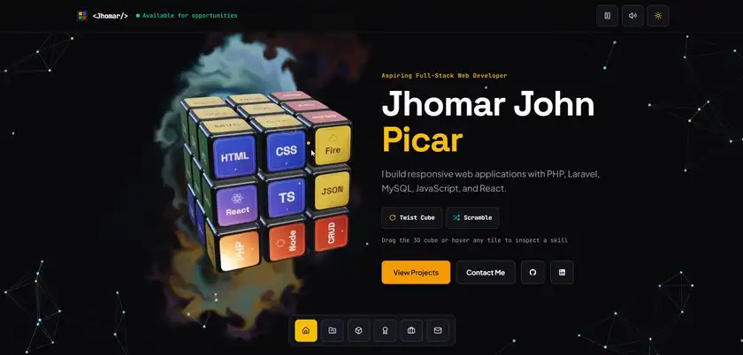

<p align="center">
  
</p>

<h1 align="center">Jhomar John Picar | 3D Rubik's Cube Portfolio</h1>

<p align="center">
  <a href="./assets/portfolio-demo.mp4">
    
  </a>
</p>

<p align="center">
  Interactive 3D developer portfolio built with React, TypeScript, Tailwind CSS v4, Framer Motion, WebGL Fluid, and Three.js. All 54 stickers on the playable 3x3x3 Rubik's Cube map to skills across six domains.
</p>

## Highlights
- Playable 3D Rubik's Cube with 90-degree slice rotations, scramble/solve unwind, keyboard notation (`U`, `D`, `L`, `R`, `F`, `B`, `Shift` for prime, `Space` to twist), drag orbit, and Web Audio click SFX.
- Real-time GPU WebGL Navier-Stokes fluid trails layered with an interactive ambient node-links network.
- Spring-magnification `FloatingDock` navigation, hover-scrolling project preview viewports with 3D perspective tilt, and focus-managed detail modals.
- WCAG AA checked dark and light themes, keyboard focus management, skip link, 44px touch targets, and a 1-click Pause 3D and Motion 2D fallback mode.
- Certifications showcase with full preview modal and PDF download, experience timeline, and validated Contact Form with loading, error, and success states.
- Static Vite output configured for Vercel and GitHub Pages.

## Local Development

```bash
npm install
npm run dev
```

## Customization
Edit files under `src/data/`:
- `src/data/config.ts`: Name, bio, email, LinkedIn URL, GitHub handle, and optional Formspree/Web3Forms `contactEndpoint`.
- `src/data/skills.ts`: All 54 Rubik's Cube skill tiles across six faces.
- `src/data/experience.ts`: Career and training timeline items.
- `src/data/certifications.ts`: Earned and planned certifications (drop images into `public/certificates/` and set `imageUrl` to enable lightbox previews).
- `src/data/projects.ts`: Project cards, stack lists, and optional `imageUrl` screenshots.

## Deployment
- **Vercel**: Import the repo. Vercel auto-detects Vite (`npm run build`, output `dist`).
- **GitHub Pages**: Push to `main` and enable Settings > Pages > GitHub Actions (`.github/workflows/deploy-pages.yml`).
